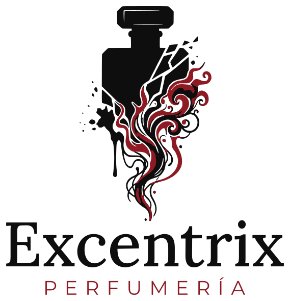
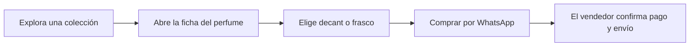
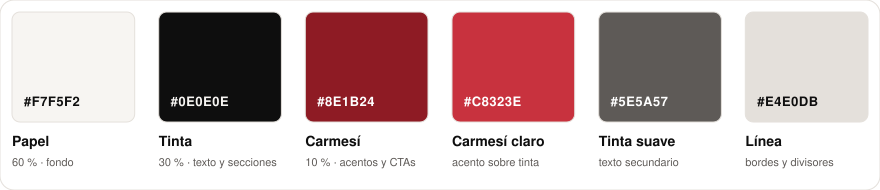
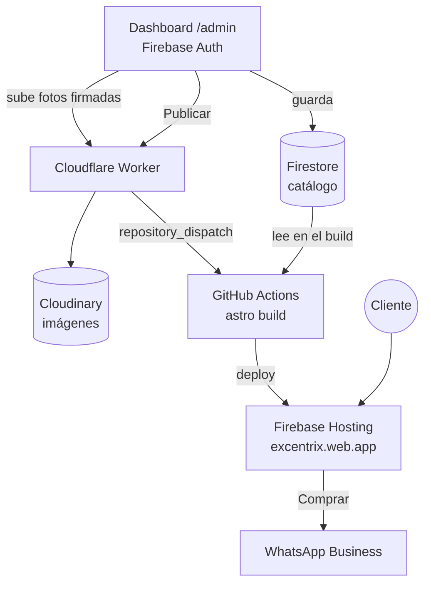

<div align="center">

<a href="https://excentrix.web.app">
  <picture>
    <source media="(prefers-color-scheme: dark)" srcset="public/brand/logo-completo-negativo.svg">
    
  </picture>
</a>

<br>
<br>

**Perfumería de nicho, diseñador y árabe — en frasco completo y en decants.**
<br>
Elige tu fragancia, escoge la presentación y cierra tu compra directamente por WhatsApp.

<br>

[](https://excentrix.web.app)


</div>

---

## La tienda

Excentrix es un catálogo de perfumes pensado para descubrir, comparar y comprar sin fricción.
No hay carrito ni pasarela de pago: cada fragancia lleva al cliente a una conversación de WhatsApp
con el pedido ya escrito, donde el vendedor cierra la venta de forma personal.

<table>
  <tr>
    <td width="33%" valign="top">
      <h3>Colecciones curadas</h3>
      Nuevos lanzamientos, Ofertas, Hombre, Mujer, Unisex, Nicho, Diseñador, Árabe, Decants, Sets y
      Bajo encargo. Varias secciones se llenan solas según las características de cada perfume.
    </td>
    <td width="33%" valign="top">
      <h3>Frascos y decants</h3>
      Cada perfume se ofrece en frasco completo (nuevo o tester) y en decants de 3, 5 y 10 ml, para
      probar una fragancia antes de invertir en el frasco.
    </td>
    <td width="33%" valign="top">
      <h3>Compra por WhatsApp</h3>
      El cliente elige la presentación y con un toque abre WhatsApp con el perfume, el tamaño, el
      precio y el enlace a la ficha.
    </td>
  </tr>
</table>

### Cómo compra un cliente



Ejemplo del mensaje que recibe el vendedor:

```text
Hola Excentrix, quiero comprar:
Dynasty – Lattafa · Decant 10 ml — $ 49.999
https://excentrix.web.app/perfume/dynasty-lattafa
```

---

## Identidad de marca

<div align="center">
  <picture>
    <source media="(prefers-color-scheme: dark)" srcset="public/brand/logo-horizontal-negativo.svg">
    
  </picture>
</div>

<br>

El isotipo, un frasco que se quiebra y libera humo carmesí, resume la marca: lo clásico que se
rompe para dar paso a lo excéntrico. La dirección visual es **editorial de lujo**: tipografía serif
de alto contraste, mucho espacio en blanco y el rojo usado solo como acento.

<div align="center">
  
</div>

| Uso                       | Tipografía             | Dónde                                                |
| ------------------------- | ---------------------- | ---------------------------------------------------- |
| Títulos y nombre de marca | **Lora** 500/600       | "Excentrix", nombres de perfumes, encabezados        |
| Interfaz y cuerpo         | **Montserrat** 400/500 | Textos, botones y etiquetas en mayúsculas espaciadas |

<details>
<summary><strong>Paquete de marca</strong></summary>
<br>

Todos los logos son SVG vectoriales sin dependencia de fuentes, en versión para fondo claro y
negativa para fondo oscuro.

| Archivo                                                   | Uso                                                |
| --------------------------------------------------------- | -------------------------------------------------- |
| [`logo-completo.svg`](public/brand/logo-completo.svg)     | Isotipo sobre el nombre: portadas, redes, impresos |
| [`logo-horizontal.svg`](public/brand/logo-horizontal.svg) | Encabezado del sitio                               |
| [`isotipo.svg`](public/brand/isotipo.svg)                 | Avatar, marcas de agua, sellos                     |
| [`favicon.svg`](public/brand/favicon.svg)                 | Ícono simplificado para tamaños pequeños           |
| [`og-default.png`](public/brand/og-default.png)           | Vista previa al compartir enlaces                  |

Los SVG maestros, las fuentes y el script que los genera están en [`brand/`](brand/README.md).

</details>

---

## Arquitectura

Sitio **estático** generado con Astro: cada perfume y colección se pre-renderiza como HTML para
cargar rápido y posicionar bien en Google. El catálogo se administra desde un dashboard privado
y se publica con un botón.



| Capa           | Tecnología                                                               |
| -------------- | ------------------------------------------------------------------------ |
| Framework      | Astro 7 · TypeScript estricto · islas Preact                             |
| Estilos        | Tailwind CSS v4 con tokens de marca                                      |
| Datos y acceso | Firestore · Firebase Auth (plan Spark)                                   |
| Imágenes       | Cloudinary (formato y tamaño automáticos)                                |
| Mini backend   | Cloudflare Worker (firma de subidas y publicación)                       |
| Admin          | React · shadcn/ui                                                        |
| Búsqueda       | Pagefind                                                                 |
| CI/CD          | GitHub Actions → Firebase Hosting (preview por PR, producción en `main`) |

El código está organizado en **módulos por dominio**: `catalog`, `product`, `whatsapp`, `search`,
`content` y `admin`, sobre una capa `shared`. Las reglas de dependencia están en
[ARQUITECTURA.md](ARQUITECTURA.md).

```text
src/
├─ pages/        rutas delgadas
├─ modules/      catalog · product · whatsapp · search · content · admin
└─ shared/       config · lib · layouts · styles · ui
```

---

## Desarrollo local

**Requisitos:** Node.js 22.23.4 o superior (el proyecto usa Node 24, ver [`.nvmrc`](.nvmrc)).

```bash
git clone https://github.com/AresHidalgo/Excentrix.git
cd Excentrix
npm install
cp .env.example .env
npm run dev
```

El sitio queda en `http://localhost:4321`.

| Comando           | Acción                                  |
| ----------------- | --------------------------------------- |
| `npm run dev`     | Servidor de desarrollo                  |
| `npm run build`   | Genera el sitio estático en `dist/`     |
| `npm run preview` | Sirve el build localmente               |
| `npm run check`   | Revisión de tipos de Astro y TypeScript |
| `npm run lint`    | ESLint                                  |
| `npm run format`  | Formatea con Prettier                   |

> Las credenciales (`.env`, cuentas de servicio de Firebase) nunca se suben al repositorio.
> En CI viven en GitHub Secrets.

### Despliegue

| Evento                       | Resultado                                                     |
| ---------------------------- | ------------------------------------------------------------- |
| Pull request a `main`        | Revisión de calidad y URL de vista previa temporal            |
| Push a `main`                | Publicación en [excentrix.web.app](https://excentrix.web.app) |
| Botón **Publicar** del admin | Reconstruye el sitio con el catálogo actualizado              |

El trabajo se hace en ramas `feature/*` y entra a `main` por pull request.

---

## Hoja de ruta

- [x] **Fase 0 · Fundaciones** — proyecto, arquitectura modular, logo vectorial, CI/CD, sitio en línea
- [ ] **Fase 1 · Diseño** — sistema de diseño y maquetas de inicio, colección, ficha y admin
- [ ] **Fase 2 · Datos y admin** — esquemas, reglas, login, CRUD, subida a Cloudinary
- [ ] **Fase 3 · Sitio público** — catálogo, filtros, ficha, compra por WhatsApp, búsqueda
- [ ] **Fase 4 · Publicación** — botón Publicar, Worker y respaldos
- [ ] **Fase 5 · Lanzamiento** — SEO, analítica, accesibilidad y catálogo real

El plan completo está en [PLAN-EXCENTRIX.md](PLAN-EXCENTRIX.md).

---

<div align="center">
  
  <br>
  <sub>© 2026 Excentrix Perfumería. Todos los derechos reservados sobre la marca y el código.</sub>
  <br>
  <sub>Las fuentes Lora y Montserrat se distribuyen bajo la SIL Open Font License.</sub>
</div>
